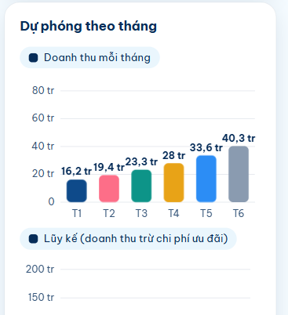
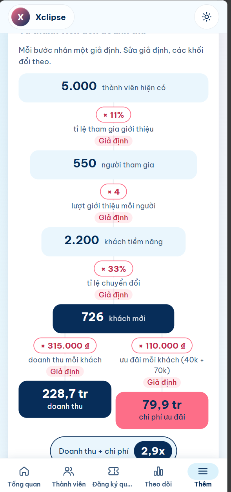
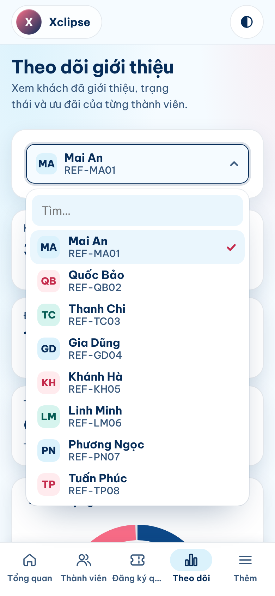
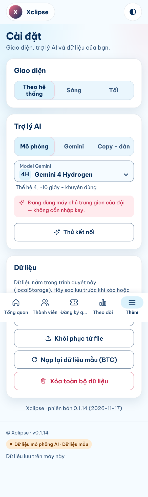

# Minh chứng dùng AI để xây dựng và cải thiện sản phẩm: Xclipse

**Đội:** Xclipse (Diệu Anh, Vũ Trí Dũng, Nguyên – nhóm trưởng) · **Công cụ AI:** Claude (Opus, Sonnet, Haiku), Claude Design, Claude in Chrome; Gemini Antigravity

> Tối đa **1 trang A4** và **5 ảnh**. Mỗi ảnh là ảnh chụp thật cuộc trò chuyện hoặc màn hình. Che API key, email và số điện thoại thật trước khi chụp hoặc nộp.

Mỗi vòng trả lời đủ 5 mục: **mục tiêu → yêu cầu cho AI → vấn đề phát hiện khi thử → yêu cầu sửa → kết quả kiểm tra lại**. Kết quả phải là thứ đo được hoặc quan sát được, không ghi "đã tốt hơn".

## Vòng 1: Hai nút thử nhanh ở "Đăng ký qua mã" cho kết quả giống nhau

| Mục | Nội dung |
|---|---|
| Mục tiêu | Demo được 2 ca chống gian lận khác nhau: tự giới thiệu và khách trùng |
| Yêu cầu cho AI | Claude Code: "check lại vì sao nút tự giới thiệu và nút thử khách trùng nhấn vào chả khác gì nhau" |
| Vấn đề khi thử | Nút "Thử khách trùng" điền mã khách (KD-…) vào ô SĐT nên form báo lỗi SĐT, không ra trạng thái "Từ chối – trùng" |
| Yêu cầu sửa | Mỗi nút tự điền một ca đúng nghĩa rồi tự gửi, kèm thông báo giải thích |
| Kết quả kiểm tra lại | Nút 1 ra "Không hợp lệ – tự giới thiệu", nút 2 ra "Từ chối – trùng"; `tests/referral.cjs` OK |

## Vòng 2: Dropdown và nút thẻ hiển thị lệch trên điện thoại

| Mục | Nội dung |
|---|---|
| Mục tiêu | Dropdown chọn thành viên/gói và nút trong thẻ chuyên nghiệp ở 390px |
| Yêu cầu cho AI | Gửi ảnh chụp lỗi; yêu cầu "tự thiết kế dropdown custom, xem mẫu Lucian Lab" |
| Vấn đề khi thử | Nút trong thẻ đè lên nhau; select gốc của trình duyệt xấu, bản bottom sheet đầu tiên chưa đạt |
| Yêu cầu sửa | Dropdown kiểu Lucian: avatar chữ cái, 2 dòng, ô tìm kiếm, dấu chọn; nút thẻ có nhãn, lưới 2 cột |
| Kết quả kiểm tra lại | Ảnh 3; smoke 360/390 đạt, nút ≥ 48px, không tràn ngang |

## Vòng 3: Trang Dự phóng: số dính nhau, căn lệch, hòa vốn ra 0

| Mục | Nội dung |
|---|---|
| Mục tiêu | Dự phóng trực quan, đúng số BTC (90 khách, 16,2 tr, 5,4 tr, 3,0x) |
| Yêu cầu cho AI | Gửi ảnh 1–2: "số dính vào nhau, căn chỉnh không thẳng hàng, dư nhiều khoảng trắng" |
| Vấn đề khi thử | Nhãn cột đè nhau, bảng tháng vỡ thành thẻ lệch, dòng "hòa vốn" luôn = 0 vì không có chi phí cố định, nút Cài đặt xuống 3 dòng (ảnh 4 là bản đã sửa) |
| Yêu cầu sửa | Phễu gọn, thẻ ngưỡng hòa vốn đúng (ưu đãi 60k / quảng cáo 90k / doanh thu 180k), 3 thẻ kịch bản, nút Cài đặt 1 cột |
| Kết quả kiểm tra lại | Số khớp KD_DuPhong; smoke 330 kiểm tra đạt, 0 lỗi |

## Ảnh minh chứng

1. Vòng 3, ảnh lỗi gửi cho AI: nhãn biểu đồ cột đè nhau

   

2. Vòng 3, ảnh lỗi gửi cho AI: phễu quá cao, căn lệch

   

3. Vòng 2, kết quả: dropdown chọn thành viên kiểu Lucian

   

4. Vòng 3, kết quả: nút Cài đặt xếp 1 cột

   

## Bài học

AI (Claude Code điều phối nhiều agent Sonnet/Haiku song song) làm nhanh, nhưng lỗi chỉ lộ ra khi đội tự bấm thử trên điện thoại. Gửi ảnh chụp lỗi kèm mô tả cụ thể giúp AI sửa đúng chỗ; mọi lần sửa đều chạy lại test tự động trước khi đẩy lên.
